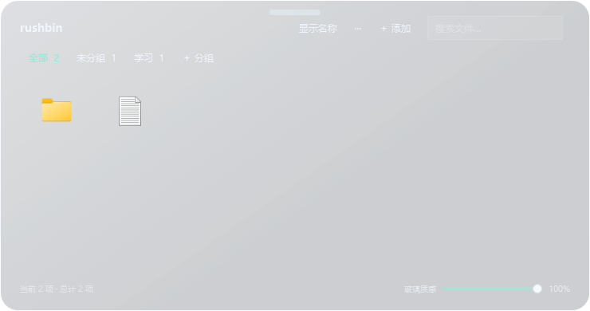
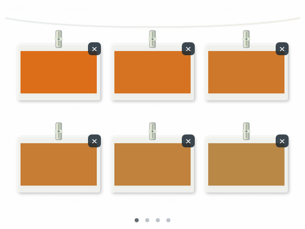

# rushbin

一个 Windows 桌面组件集合：用可调节的玻璃面板整理桌面文件、快捷方式和常用操作。项目受 [GlassBoard](https://github.com/SENLIN-SAMA/win-.-) 启发，是独立实现，并非原项目的官方版本或源码发布。

> 这是在个人 Windows 电脑上逐步开发的实验性项目。不同版本的 Windows、DPI、多显示器、无线网卡和第三方托盘程序上的表现可能不同，请先备份重要文件和系统设置。

## 预览

以下图片由程序在隔离测试数据下渲染，展示布局；透明背景在网页上的效果不等同于真实桌面的玻璃合成效果。

| 截图晾衣架（示例图） | 状态挂件（示例） |
| --- | --- |
|  |  |

## 组件

- rushbin 面板：文件和应用入口、搜索、分组、拖动排序及玻璃质感调节。
- rushbin·文件：桌面文件访问、拖入拖出、排序、缩略图和右键删除至回收站。
- 底栏：固定应用、运行状态、悬停窗口预览、消息提示和按住时临时置顶。
- 控制中心：音量、亮度、Wi-Fi、蓝牙、电池、托盘图标与任务管理器入口；具体能力取决于设备。
- 状态挂件：时钟与 CPU/GPU 等状态；无法获取的数据显示 N/A，当前不提供 FPS 测量。
- 截图晾衣架：保存剪贴板图片、拖入图片、删除、排序及自适应分页。
- 组件管理：组件开关、背景设置和组件显示快捷键。

## 开始使用

可下载 [Windows 程序包](downloads/rushbin-windows.zip)，解压后双击 `DeskBox.exe`；也可以按 [构建说明](docs/BUILD.md) 从源码构建。程序包是未签名的实验版本，仅在开发环境进行过验证。

请先阅读 [使用说明](docs/使用说明.md) 的“系统行为与数据位置”。程序可能隐藏 Windows 任务栏，按 F12 可切换恢复；退出时也会尝试恢复原来的状态。

| 默认按键 | 作用 |
| --- | --- |
| F1 | 打开或收起组件管理 |
| F5 | 打开或收起主面板 |
| F4 | 轻按保存最近剪贴板图片；按住临时置顶截图架 |
| Shift+F4 | 切换截图架显示（可在组件管理中修改） |
| F6 | 按住临时显示底栏，松开恢复桌面层级 |
| F12 | 隐藏或恢复 Windows 任务栏 |

组件管理提供各组件的显示/收起快捷键设置。F4、F6、F12 的特殊行为目前仍是固定按键；已有设置或系统占用可能改变实际效果。

## 系统行为与隐私

程序以当前用户身份运行。它使用 Windows API 读取应用窗口、桌面入口、剪贴板图片、系统状态和托盘信息。自绘托盘使用本项目原生桥接代码监听 Explorer 的托盘消息；无线、音量和亮度控件会在用户操作时更改相应系统状态。

程序可隐藏 Windows 任务栏；消息提示功能可能临时修改当前用户的任务栏闪烁与角标设置，并保存旧值以尝试恢复。项目尚未经过全面安全审计，也不保证在所有异常退出或 Explorer 重启场景中恢复成功。更多细节见[使用说明](docs/使用说明.md)。

配置和截图副本位于 `%LOCALAPPDATA%\DeskBox`。添加桌面外的普通文件或文件夹时，程序会复制到系统实际桌面目录；应用程序通常创建快捷方式。删除“入口”和删除实际文件是不同操作。

## 构建与贡献

- [构建说明](docs/BUILD.md)
- [使用说明](docs/使用说明.md)
- [第三方参考与许可说明](THIRD_PARTY_NOTICES.md)
- [贡献指南](CONTRIBUTING.md)

## 许可与致谢

本仓库的独立实现代码按 [MIT 许可](LICENSE)发布。构建所需 TinyCC 为单独下载的第三方工具，采用自身许可；Windows、第三方应用图标及原项目名称和素材分别属于各自权利人，不随本仓库代码许可授权。感谢 [SENLIN-SAMA 的 GlassBoard](https://github.com/SENLIN-SAMA/win-.-) 提供的体验灵感。
